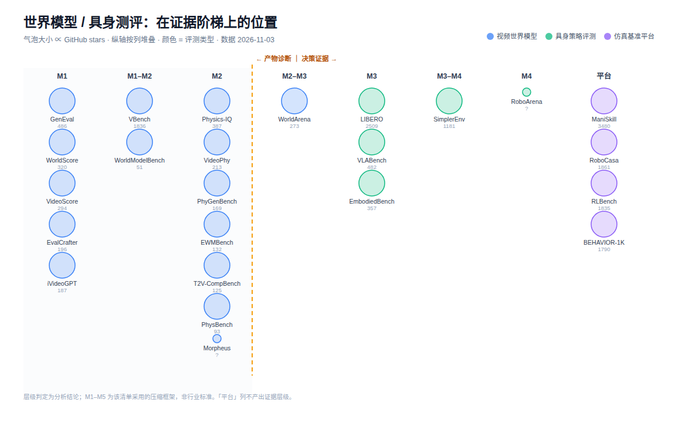

# World Model / Embodied Evaluation Benchmarks

世界模型与具身智能的**评测方法**清单 — 不是模型清单，是「怎么测」的清单。

按 GitHub Stars 排序，标注证据层级（L0–L7 → M1–M5）与许可证。
数据于 <!-- BEGIN:STAMP -->
2026-11-03
<!-- END:STAMP --> 由 GitHub API 自动读取，每周刷新。



## 全图怎么看

横轴是证据成熟度，不是"好不好"。右边更成熟 = 更能支撑决策。

- **M1–M2 产物诊断** — 判断生成的东西像不像、某一项物理对不对
- **M3–M4 决策证据** — 判断结论能否预测真实结果
- **M5 认证问责** — 有标准、有认证、有人签字担责

橙色虚线是分界：**左侧验的是"产物"，右侧验的是"决策"**。

## 1. 视频世界模型 / 生成真实度（<!-- BEGIN:VIDEO_N -->
15
<!-- END:VIDEO_N --> 项）

<!-- BEGIN:VIDEO_TABLE -->
| 项目 | Stars | 许可证 | L | M |
|---|---:|---|---|---|
| VBench | **1,836** | Apache-2.0 | L0–L3 | M1–M2 |
| GenEval | **486** | MIT | L1–L2 | M1 |
| Physics-IQ | **387** | NOASSERTION | L3 | M2 |
| WorldScore | **320** | MIT | L1–L2 | M1 |
| VideoScore | **294** | MIT | L1–L2 | M1 |
| WorldArena | **273** | 无 LICENSE | L2–L3 | M2–M3 |
| VideoPhy | **213** | MIT | L2–L3 | M2 |
| EvalCrafter | **196** | 无 LICENSE | L1–L2 | M1 |
| iVideoGPT | **187** | MIT | L1–L2 | M1 |
| PhyGenBench | **169** | 无 LICENSE | L3 | M2 |
| EWMBench | **132** | 无 LICENSE | L2–L3 | M2 |
| T2V-CompBench | **125** | 无 LICENSE | L2 | M2 |
| PhysBench | **93** | Apache-2.0 | L2–L3 | M2 |
| WorldModelBench | **51** | 无 LICENSE | L1–L3 | M1–M2 |
| Morpheus | 未核实 | 未知 | L3 | M2 |
<!-- END:VIDEO_TABLE -->

**这一组最高只到 M2。** 全部属于产物诊断层。

## 2. 具身策略评测（<!-- BEGIN:POLICY_N -->
5
<!-- END:POLICY_N --> 项）

<!-- BEGIN:POLICY_TABLE -->
| 项目 | Stars | 许可证 | L | M |
|---|---:|---|---|---|
| LIBERO | **2,509** | MIT | L5 | M3 |
| SimplerEnv | **1,181** | MIT | L5–L6 | M3–M4 |
| VLABench | **482** | MIT | L4–L5 | M3 |
| EmbodiedBench | **357** | 无 LICENSE | L4–L5 | M3 |
| RoboArena | 未核实 | 未知 | L6 | M4 |
<!-- END:POLICY_TABLE -->

**唯一进入 M3–M4 的组。** 差别在于它们把仿真分数和真机结果做了相关性验证。

## 3. 仿真基准平台（<!-- BEGIN:SIM_N -->
4
<!-- END:SIM_N --> 项）

<!-- BEGIN:SIM_TABLE -->
| 项目 | Stars | 许可证 | 最近推送 |
|---|---:|---|---|
| ManiSkill | **3,480** | Apache-2.0 | 2026-08-04 |
| RoboCasa | **1,861** | NOASSERTION | 2026-10-30 |
| RLBench | **1,835** | NOASSERTION | 2025-01-25 |
| BEHAVIOR-1K | **1,790** | MIT | 2026-11-02 |
<!-- END:SIM_TABLE -->

平台本身不产出证据层级；层级取决于拿它做什么验证。

## 三个结论

1. **视频侧 15 项，没有一个超过 M2。** 密度极高，成熟度很低。
2. **成熟度只出现在机器人侧。** 真机经验验证才是分水岭，不是渲染质量。
3. **全域零 M5。** 无第三方认证、无合同验收门限、无签字担责。

## 许可证风险（<!-- BEGIN:NO_LICENSE_N -->
9
<!-- END:NO_LICENSE_N --> 个无 LICENSE）

<!-- BEGIN:NO_LICENSE -->
`WorldArena`、`EvalCrafter`、`PhyGenBench`、`EWMBench`、`T2V-CompBench`、`WorldModelBench`、`Morpheus`、`EmbodiedBench`、`RoboArena`
<!-- END:NO_LICENSE -->

这些仓库没有 LICENSE 文件，默认「保留所有权利」。商用、再分发或写入交付物前必须单独取得授权。
`Physics-IQ`、`RoboCasa`、`RLBench` 为 `NOASSERTION`，需人工阅读条款。

## 持续监控

`data/benchmarks.csv` 是唯一事实源。每周一 GitHub Actions 自动运行：

```
scripts/update.py
```

它拉取每个仓库的 stars、forks、open issues、最近推送、最新 release、是否归档，
写入 `data/metrics.csv`，并重新生成本页表格与 `docs/positioning.svg`。

本地手动刷新：

```bash
GITHUB_TOKEN=... python3 scripts/update.py
```

新增条目：在 `data/benchmarks.csv` 加一行（`repo` 填 `owner/name`），跑一次脚本即可。

## 怎么读这张表

- **L 层级**是原始定位（L0–L7），**M 层级**是压缩后的跨域尺（M1–M5）。
- 层级说的是**证据能支撑什么决定**，不是基准写得好不好。
- 判定是分析结论，非仓库自述；有争议时以原始论文为准。

## 未纳入

- `Morpheus`、`RoboArena`：未找到可确认的公开仓库，标 `PENDING` 而非猜测链接。
- 自动驾驶世界模型评测、底层视频质量指标（FVD/LPIPS 类）、纯模型仓库：不属于「评测方法」。

## 目录

```
data/benchmarks.csv         事实源（人工维护元数据与层级）
data/metrics.csv            自动抓取的活跃度指标
docs/positioning.svg        生成的全景图
docs/ladder-mapping.md      L0–L7 ↔ M1–M5 映射
scripts/update.py           抓取 + 重生成
evals/video/                视频世界模型评测
evals/policy/               具身策略评测
evals/sim/                  仿真基准平台
```

## 来源

层级映射依据 Muse 报告《同一个尺子量三件事：航天 V&V · 大语言模型 · 世界模型》。
M1–M5 是该报告的分析框架，不是已确立的行业标准。
